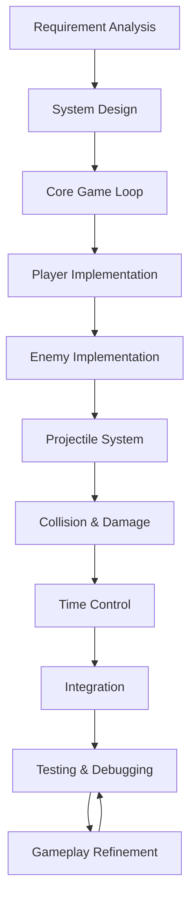
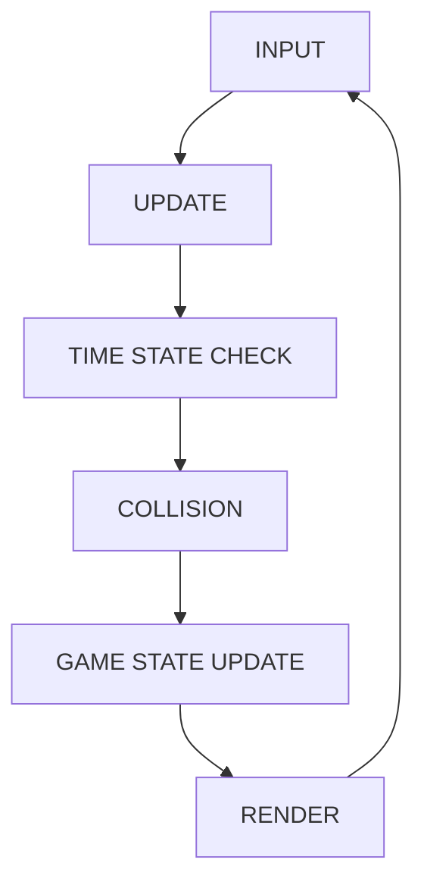
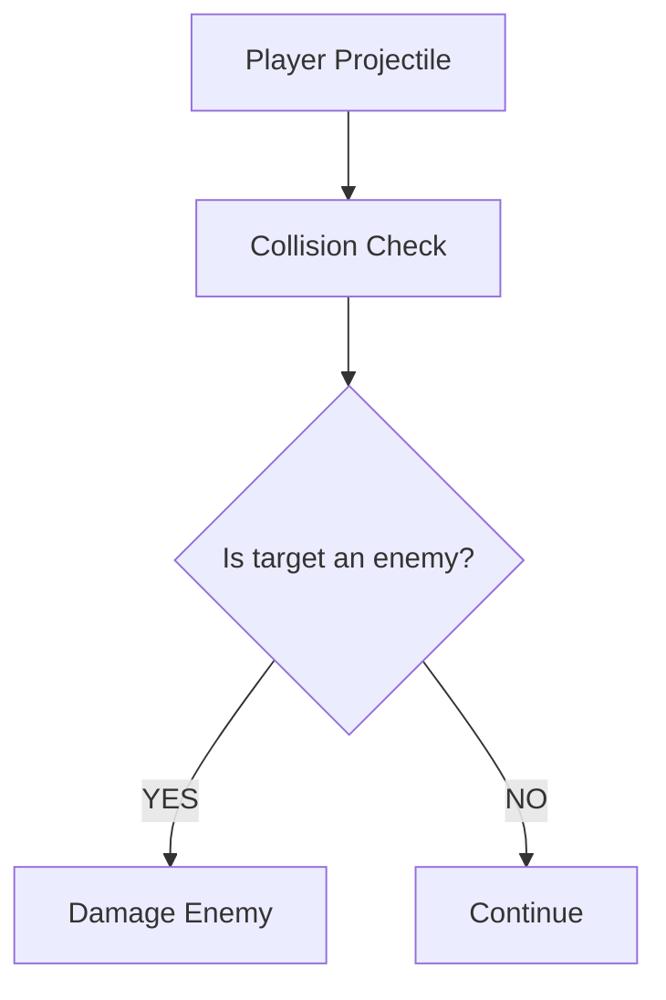
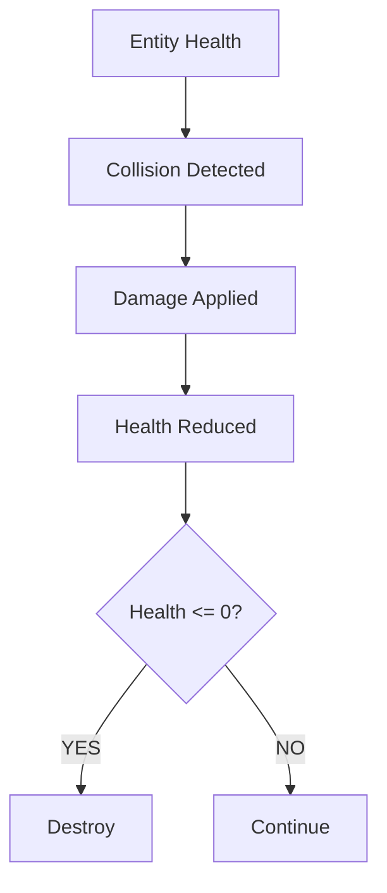

<div align="center">

# ZEROTH SECOND
### A Real-Time 2D Combat Game with Time Manipulation Using Python

**Project Exhibition I – Project Documentation**

> *“When Time Stops, Every Second Becomes a Fight.”*


</div>

---

## Table of Contents

<details>
<summary>Click to expand</summary>

1. [Abstract](#1-abstract)
2. [Introduction](#2-introduction)
3. [Problem Statement](#3-problem-statement)
4. [Motivation](#4-motivation)
5. [Objectives](#5-objectives)
6. [Scope of the Project](#6-scope-of-the-project)
7. [Game Concept](#7-game-concept)
8. [Gameplay Mechanics](#8-gameplay-mechanics)
9. [Time Manipulation System](#9-time-manipulation-system)
10. [Game Architecture](#10-game-architecture)
11. [Development Methodology](#11-development-methodology)
12. [Application of Engineering Principles](#12-application-of-engineering-principles)
13. [Technology Stack](#13-technology-stack)
14. [Game Loop](#14-game-loop)
15. [Collision Detection](#15-collision-detection)
16. [Health and Damage System](#16-health-and-damage-system)
17. [User Interface](#17-user-interface)
18. [Arena Design](#18-arena-design)
19. [Testing](#19-testing)
20. [Debugging and Problem Solving](#20-debugging-and-problem-solving)
21. [Challenges](#21-challenges)
22. [Project Outcome](#22-project-outcome)
23. [Ethical, Social, and Environmental Considerations](#23-ethical-social-and-environmental-considerations)
24. [Limitations](#24-limitations)
25. [Future Scope](#25-future-scope)
26. [Conclusion](#26-conclusion)
27. [References](#27-references)

</details>

---

## 1. Abstract
**Zeroth Second** is a real-time 2D combat game developed using Python. The project combines interactive gameplay with fundamental Computer Science concepts such as Object-Oriented Programming, modular software design, real-time event processing, collision detection, projectile management, game-state management, and debugging.

The game is designed around a time-manipulation concept, where the player can interact with the flow of time during combat. This creates a gameplay environment in which the player must make strategic decisions while managing movement, aiming, shooting, enemy attacks, and survival.

The game uses a top-down arena containing obstacles, a player-controlled human character, enemy characters, projectiles, and health/damage mechanics. The system is designed using separate modules for the game engine, player, enemies, projectiles, collision handling, and game state.

The primary objective is not only to create an entertaining game but also to demonstrate how programming and software engineering principles can be applied to develop a real-time interactive application.

---

## 2. Introduction
Video games provide a practical environment for applying several areas of Computer Science simultaneously. Unlike conventional applications, a real-time game continuously receives user input, updates multiple objects, checks interactions, manages game states, and renders the resulting environment.

**Zeroth Second** was developed as a practical application of these concepts. The game follows a top-down 2D combat format. The player controls a human character inside an arena and must survive encounters with enemy characters. The environment contains obstacles that affect movement and combat.

The defining concept of the project is time manipulation. Instead of relying only on traditional shooting mechanics, the game introduces the idea that the player can control or interrupt the flow of time. This creates opportunities for strategic decision-making and differentiates the project from a conventional shooter.

---

## 3. Problem Statement
Developing a real-time combat game requires multiple systems to operate simultaneously and interact correctly. The system must process continuous input, update game entities, detect collisions, manage health and damage, control enemy behavior, maintain a consistent game state, and coordinate time-dependent behavior.

> [!IMPORTANT]
> **Problem Statement:** To design and develop a modular real-time 2D combat game using Python that integrates player control, enemy behavior, projectile-based combat, collision detection, health management, and time manipulation into a reliable and interactive gameplay system.

---

## 4. Motivation
- Explore practical applications of Python and Object-Oriented Programming.
- Understand how real-time software systems process continuous events.
- Implement theoretical programming concepts in a functional application.
- Develop a project involving multiple interacting software components.
- Gain practical experience in debugging and iterative development.
- Create a foundation that can be expanded into a larger game system.

Games provide a practical environment for implementing the real-time cycle:

```
Input → Processing → Decision Making → Interaction → Output
```

---

## 5. Objectives
1. Develop a functional real-time 2D combat game.
2. Implement a responsive player-control system.
3. Implement player aiming and projectile-based shooting.
4. Develop enemy characters with combat behavior.
5. Implement collision detection between game entities.
6. Implement health and damage mechanics.
7. Design the game using Object-Oriented Programming principles.
8. Separate game functionality into modular components.
9. Introduce a time-manipulation mechanic as a central gameplay concept.
10. Test and debug the interaction between different game systems.
11. Create a foundation for additional levels, enemies, weapons, and gameplay mechanics.

---

## 6. Scope of the Project

### 6.1 Current Scope
- Top-down 2D gameplay
- Player movement and aiming
- Player shooting
- Enemy characters with targeting and shooting behavior
- Projectile management
- Collision detection
- Health and damage
- Arena obstacles
- Game-state management
- Real-time game loop
- Time-manipulation concept

### 6.2 Future Scope
- Multiple levels and difficulty progression
- Advanced enemy AI and pathfinding
- Boss encounters
- Different enemy types and combat behaviors
- Weapon upgrades and power-ups
- Expanded time manipulation such as slow motion or rewind
- Time-based puzzles and temporal abilities
- Score and leaderboard systems
- Sound effects, music, animation, and improved visual effects
- Save/load functionality

---

## 7. Game Concept
The player is placed inside a combat arena populated by hostile enemies. The basic gameplay cycle is:

```
Explore → Aim → Attack → Avoid → Manipulate Time → Survive
```

The player must use movement and shooting to eliminate enemies while avoiding incoming attacks.

The unique element is time manipulation. The player can use time as a gameplay resource rather than simply experiencing the game at a constant speed. The mechanic is intended to create a strategic window in which the player can alter the immediate combat situation.

---

## 8. Gameplay Mechanics

### 8.1 Player Movement
The player can move around the arena using keyboard controls. Movement allows the player to navigate obstacles, avoid enemy projectiles, position strategically, and approach or retreat from enemies.

### 8.2 Aiming
The mouse is used to determine the direction of attack. The player's weapon direction is determined relative to the mouse position.

### 8.3 Shooting
The player can fire projectiles toward the target direction. The projectile system manages creation, direction, movement, ownership, collision, damage, and removal.

### 8.4 Enemy Behavior
Enemy characters act as hostile entities. Their behavior can include positioning, targeting the player, firing projectiles, responding to player attacks, and receiving damage.

### 8.5 Collision
Collision detection determines when two game objects interact, including player projectiles hitting enemies, enemy projectiles hitting the player, and entities interacting with arena obstacles.

### 8.6 Health and Damage
When a valid damaging collision occurs, the target's health is reduced. The process follows:

```
Collision → Target Identification → Damage → Health Update → Death Condition
```

---

## 9. Time Manipulation System
Time manipulation is the primary feature that differentiates **Zeroth Second** from a conventional top-down shooter. A traditional game continuously updates all objects according to the game clock. In **Zeroth Second**, the temporal state can be manipulated so that selected entities do not behave according to their normal progression.

| Entity / System | 9.1 Normal State | 9.2 Time-Stop State |
| :--- | :--- | :--- |
| **Player** | Moving | Controlled |
| **Enemies** | Moving | Frozen |
| **Projectiles** | Moving | Enemy Projectiles Frozen |
| **Game World / Environment** | Updating | Frozen |

Conceptually, the game can determine whether time-dependent objects receive their normal update operations. This can later be extended to slow motion, rewind, time acceleration, temporal energy, cooldowns, and other abilities.

---

## 10. Game Architecture
The system follows a modular architecture in which each major responsibility is separated into a logical component:

- **Game Engine:** Coordinates the main game loop, input processing, updates, timing, rendering, and resources.
- **Time Control:** Controls the state of time and determines how time-dependent systems behave.
- **Player Module:** Responsible for input, movement, aiming, shooting, health, and time-control actions.
- **Enemy Module:** Responsible for enemy movement, targeting, shooting, combat behavior, and health.
- **Projectile Module:** Responsible for projectile creation, movement, ownership, collision, and lifecycle.
- **Collision System:** Detects interactions between game entities and arena obstacles.
- **Health/Damage System:** Processes damage and determines whether an entity remains active or is removed.
- **Game State:** Maintains information such as player health, score, level, enemy status, win/loss conditions, and time state.

---

## 11. Development Methodology
The project follows an iterative development methodology. Individual components are implemented, tested, integrated, and refined progressively.



---

## 12. Application of Engineering Principles
- **Object-Oriented Programming:** Game entities are represented as objects containing their own state and behavior.
- **Modularity:** The system is divided into logical modules that can be developed and tested independently.
- **Encapsulation:** Each component manages its relevant data and operations.
- **Abstraction:** Complex operations are represented through simpler interfaces.
- **Separation of Responsibilities:** Player, enemy, projectile, collision, and engine logic have distinct responsibilities.
- **Iterative Development:** Features are implemented progressively and refined through testing.

---

## 13. Technology Stack

| Technology / Tool | Purpose |
| :--- | :--- |
| **Python** | Core programming language |
| **Pygame** | 2D rendering, input handling, timing, graphics, and game development |
| **IDE / Code Editor** | Source-code development and debugging |
| **Git / Version Control** | Source-code version management, where used |
| **Debugging Tools** | Identification and correction of runtime and logical errors |
| **Graphic / Asset Tools** | Creation and refinement of game assets |

---

## 14. Game Loop
The game operates through a continuous real-time loop that processes input, updates entities, checks collisions, changes the game state, and renders the result.



---

## 15. Collision Detection
Collision detection is essential for combat. A projectile must determine whether it has interacted with a valid target. Projectile ownership is important because the game contains both player and enemy projectiles; ownership and target validation help prevent unintended self-damage or invalid interactions.



---

## 16. Health and Damage System
The health system determines whether a player or enemy remains active. Damage is applied only after a valid collision and target identification.



---

## 17. User Interface
The game's interface provides gameplay information while keeping the player focused on combat. Depending on the current build, the HUD can include health, score, level, remaining enemies, controls, objective information, and time-control status.

---

## 18. Arena Design
The game uses a top-down arena containing walls and obstacles. Obstacles restrict movement, influence enemy positioning, create tactical routes, and provide opportunities for cover. The arena therefore functions as part of the gameplay system rather than merely as a background.

---

## 19. Testing
Testing is performed incrementally throughout development. Each component is checked independently and then tested again after integration.

| Component | Test |
| :--- | :--- |
| **Player** | Movement responds correctly |
| **Aiming** | Weapon follows target direction |
| **Shooting** | Projectile is created correctly |
| **Enemy** | Enemy behaves and targets appropriately |
| **Projectile** | Projectile moves and is removed correctly |
| **Collision** | Valid collisions are detected |
| **Damage** | Target health decreases correctly |
| **Death** | Destroyed entities are removed |
| **Time Control** | Temporal state affects intended entities |
| **Game State** | Win/loss and gameplay conditions update correctly |

---

## 20. Debugging and Problem Solving
Real-time interactions between game objects can produce both runtime and logical problems. The project uses an iterative debugging approach in which problems are reproduced, isolated, corrected, and retested.

- **Projectile Interaction:** Incorrect projectile handling can cause unintended collisions. Projectile ownership and target validation are used to control valid interactions.
- **Damage Handling:** Damage logic must distinguish between player and enemy entities. Collision detection and damage application are separated so the target can be identified before health is modified.
- **Enemy Firing:** Enemy firing behavior requires controlled timing and targeting rather than unrestricted firing.
- **Runtime Errors:** Object/class interactions can cause errors when attributes or methods are not correctly defined. These are addressed through reproduction, isolation, code inspection, and testing.

**Debugging Cycle:**

```
Reproduce → Isolate → Debug → Modify → Test → Integrate
```

---

## 21. Challenges
1. Designing a modular architecture.
2. Managing multiple objects simultaneously.
3. Maintaining real-time game performance.
4. Handling collision detection.
5. Separating player and enemy projectiles.
6. Managing health and damage.
7. Implementing enemy behavior.
8. Coordinating time manipulation with other game systems.
9. Debugging interactions between independent modules.
10. Maintaining a consistent game state.

---

## 22. Project Outcome
The project establishes a functional foundation for a real-time 2D combat game. It demonstrates the practical application of Python programming, Object-Oriented Programming, modular design, real-time game loops, event processing, collision detection, projectile management, enemy behavior, health and damage, game-state management, and the time-manipulation concept.

The architecture is designed so that additional gameplay mechanics can be incorporated without completely restructuring the existing system.

---

## 23. Ethical, Social, and Environmental Considerations
- **Ethical Considerations:** The project is intended as an educational and entertainment software application and is not designed for real-world harmful applications.
- **Social Considerations:** The project demonstrates the use of programming for interactive entertainment and can be further developed with accessibility and user-experience considerations.
- **Environmental Considerations:** The application is designed as a relatively lightweight 2D game. Efficient object management, rendering, and update operations can reduce unnecessary computational overhead.

---

## 24. Limitations
- Limited number of enemy types.
- Basic enemy behavior.
- Limited number of levels.
- Basic visual effects.
- Limited audio integration.
- Time manipulation may initially support a limited set of interactions.
- No multiplayer functionality.
- No advanced progression system.

---

## 25. Future Scope

### 25.1 Advanced Time Manipulation
- Time freeze
- Slow motion
- Time rewind
- Time acceleration
- Time-based abilities
- Temporal energy/cooldown
- Different time effects on different entities

### 25.2 Advanced AI
- Pathfinding
- Different combat strategies
- Group behavior
- Adaptive difficulty
- Advanced targeting

### 25.3 Gameplay Expansion
- Multiple levels
- Boss battles
- Weapon upgrades
- Power-ups
- Character abilities
- Missions
- Scoreboards

### 25.4 Technical Improvements
- Improved performance
- Better animation
- Advanced particle effects
- Sound effects
- Save/load functionality
- Improved UI

> *Multiplayer is intentionally outside the scope of this project.*

---

## 26. Conclusion
**Zeroth Second** demonstrates how fundamental Computer Science concepts can be integrated into a real-time interactive application. The project combines Python programming, Object-Oriented Programming, modular architecture, real-time event processing, collision detection, projectile management, enemy behavior, health systems, and time manipulation.

The development process also demonstrates the importance of iterative testing and debugging when multiple independent systems interact within a real-time environment.

The time-manipulation concept provides the project with a distinctive gameplay identity while creating an interesting technical challenge: different game systems must respond appropriately to changes in the temporal state of the game.

Ultimately, **Zeroth Second** serves as both a playable game and a practical demonstration of software engineering principles applied to interactive system development.

---

