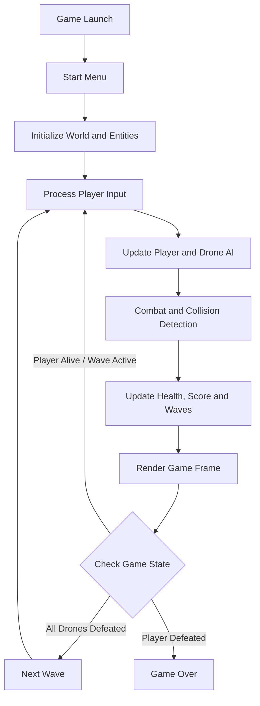

<div align="center">

# ZeroTH Second

### A 2D Top-Down Shooter with Time Manipulation, Enemy AI & Procedural Generation


</div>

---

## Table of Contents

<details>
<summary>Click to expand</summary>

- [Overview](#overview)
- [Features](#features)
- [Technologies Used](#technologies-used)
- [Project Structure](#project-structure)
- [Core Systems](#core-systems)
- [Game Workflow](#game-workflow)
- [Installation and Setup](#installation-and-setup)
- [Controls](#controls)
- [Development Concepts](#development-concepts)
- [Future Improvements](#future-improvements)
- [License](#license)

</details>

---

## Overview

**ZeroTH Second** is an action-oriented 2D top-down shooter developed using Python and Pygame, where the player fights against different types of autonomous drones across a procedurally generated environment. The game combines real-time combat with time manipulation, enemy navigation, collision detection, wave-based combat, and a modular architecture.

The project focuses on implementing core game development concepts such as object-oriented programming, finite-state machines, pathfinding algorithms, sprite animation, and real-time game loops.

---

## Features

- **Top-Down Gameplay:** Player movement, mouse-based aiming, and shooting mechanics.
- **Time Manipulation:** A time-control system that separates real-time from in-game time.
- **Multiple Enemy Types:** Three drone variants with distinct attributes:
  - **Basic** – Balanced health, speed, and attack behaviour.
  - **Scout** – Faster movement and aggressive attacks.
  - **Tank** – Higher health, slower movement, and stronger attacks.
- **Enemy AI:** Finite-state-machine behaviour with `Patrol`, `Chase`, `Attack`, and `Search` states.
- **A\* Pathfinding:** Drones navigate around obstacles to reach the player.
- **Procedural Map Generation:** Automatically generated maps with walls and walkable areas.
- **Combat System:** Projectile-based shooting, damage calculation, collision detection, and reloading.
- **Sprite Animations:** Directional idle, movement, shooting, hit, and death animations for the player and drones.
- **Wave-Based Progression:** Increasing enemy counts as the player advances through waves.
- **Graphical HUD:** Displays health, score, wave number, ammunition, and reload status.
- **Debug Overlay:** Displays development information and debugging visuals.
- **Start Menu:** Interactive Play and Quit options.

---

## Technologies Used

| Category | Technology / Concept |
| :--- | :--- |
| **Language** | Python 3.x |
| **Framework** | Pygame |
| **Architecture** | Object-Oriented Programming (OOP) |
| **Pathfinding** | A\* Pathfinding Algorithm |
| **AI Logic** | Finite State Machine (FSM) |
| **Graphics** | 2D Sprite Animation |

---

## Project Structure

```text
Zeroth Second/
│
├── main.py
├── README.md
├── requirements.txt
│
├── assets/
│   ├── fonts/
│   ├── maps/
│   ├── sounds/
│   └── sprites/
│
├── levels/
├── saves/
├── tests/
│
└── src/
    ├── ai/
    ├── engine/
    │   ├── game.py
    │   ├── camera.py
    │   ├── input.py
    │   ├── settings.py
    │   └── timer.py
    │
    ├── entities/
    │   ├── entity.py
    │   ├── player.py
    │   └── drone.py
    │
    ├── physics/
    ├── ui/
    │   └── debug.py
    │
    ├── utils/
    │
    ├── weapons/
    │   ├── weapon.py
    │   ├── pistol.py
    │   ├── weapon_manager.py
    │   └── bullet.py
    │
    └── world/
        └── world.py
```

---

## Core Systems

### 1. Game Engine
The central game controller manages initialization, the main game loop, event handling, updates, rendering, and game-state transitions.

### 2. Player System
Manages player movement, aiming, health, damage handling, weapon control, and sprite animations. Collision checks are performed independently along the horizontal and vertical axes.

### 3. Enemy AI
Drones operate through a finite state machine:
- **`PATROL`** – Move around their patrol area.
- **`CHASE`** – Pursue the player using A\* pathfinding.
- **`ATTACK`** – Maintain an appropriate combat distance and fire projectiles.
- **`SEARCH`** – Search for the player after losing line of sight.

### 4. World and Pathfinding
The world system handles procedural map generation, obstacle collision, valid spawn positions, line-of-sight detection, and A\* pathfinding.

### 5. Weapon and Combat System
The weapon system is divided into separate components for weapon behaviour, pistol configuration, weapon management, and projectile handling. It supports ammunition management, firing cooldowns, reloading, and damage calculation.

### 6. Animation System
Sprite sheets are used to animate the player and different drone variants. Animations respond to entity states, movement direction, shooting, damage, and death.

### 7. Wave Management
The game progressively spawns different drone types. Defeating all active drones advances the player to the next wave.

---

## Game Workflow



---

## Installation and Setup

### Prerequisites
- Python 3.x
- `pip`

### Steps

1. **Clone the repository:**
   ```bash
   git clone <repository-url>
   ```

2. **Navigate to the project directory:**
   ```bash
   cd "Zeroth Second"
   ```

3. **Install dependencies:**
   ```bash
   pip install -r requirements.txt
   ```

4. **Launch the game:**
   ```bash
   python main.py
   ```

---

## Controls

| Key / Input | Action |
| :--- | :--- |
| <kbd>W</kbd> / <kbd>A</kbd> / <kbd>S</kbd> / <kbd>D</kbd> | Player movement |
| **Mouse** | Aim |
| **Left Mouse Button** | Shoot |
| <kbd>R</kbd> | Reload |
| <kbd>F3</kbd> | Toggle debug overlay |
| <kbd>ESC</kbd> | Quit from start menu |

---

## Development Concepts

The project demonstrates several core software engineering and game development concepts:

- **Encapsulation:** Each class manages its own data and behaviour.
- **Inheritance:** `Player` and `Drone` share common properties through the `Entity` base class.
- **Modularity:** Game systems are separated into independent modules.
- **Finite State Machines:** Used to manage enemy behaviour.
- **Pathfinding:** A\* algorithm for obstacle-aware enemy navigation.
- **Delta Time:** Used for frame-rate-independent movement and updates.

---

## Future Improvements

- Additional enemy variants and weapons.
- More environmental assets and map variations.
- Improved enemy behaviour and combat balancing.
- Additional levels and gameplay mechanics.
- Performance optimization and expanded testing.

---

## License

This project is developed for educational and game development purposes.
